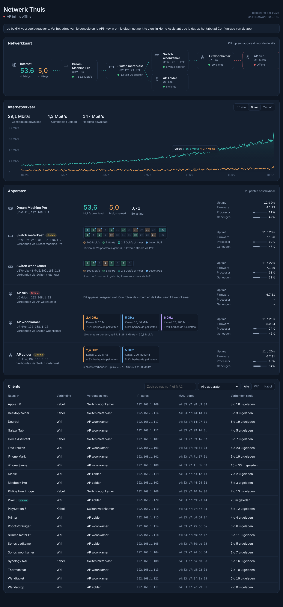
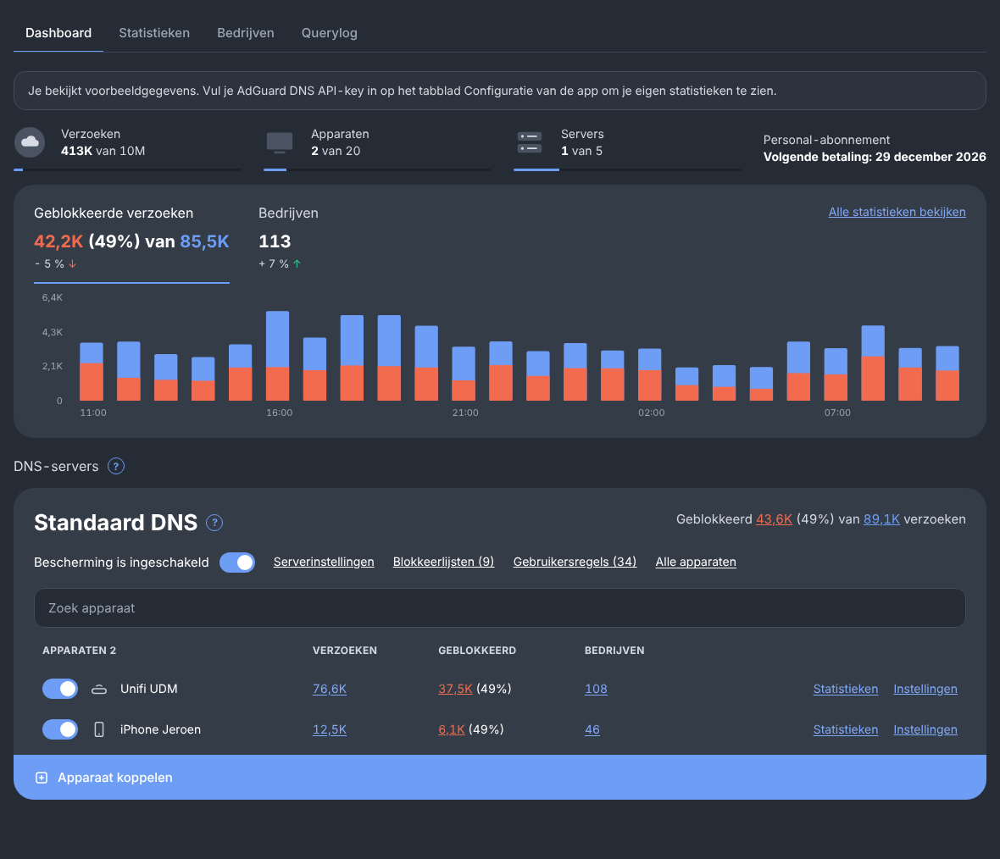

# Fonfey's Home Assistant addons

Store-repository voor Home Assistant. Hier staan de app-beschrijvingen; de code staat in de eigen repository van elke app en wordt als kant-en-klaar image geleverd.

| App | Wat het doet | Code |
|---|---|---|
| [UniFi Dashboard](unifi_dashboard/DOCS.md) | Live overzicht van je UniFi-netwerk: netwerkkaart, internetverkeer, switchpoorten, wifi-radio's en clients. | [HomeAssistantUnifi](https://github.com/Fonfey/HomeAssistantUnifi) |
| [AdGuard DNS Dashboard](adguard_dns/DOCS.md) | Statistieken van je AdGuard DNS-account, querylog, blokkeren en deblokkeren, blokkeerlijsten en serverinstellingen. | [HomeAssistantAdguard](https://github.com/Fonfey/HomeAssistantAdguard) |
| [Onderhoud](onderhoud/DOCS.md) | Eén lijst met wat aandacht nodig heeft in je Home Assistant: back-ups, offline apparaten, batterijen, automations die botsen of nooit draaien, en wat je kunt opruimen. | [HomeAssistantOnderhoud](https://github.com/Fonfey/HomeAssistantOnderhoud) |

## Installeren in Home Assistant

1. Ga naar **Instellingen → Apps → App Store**.
2. Klik rechtsboven op **⋮ → Repositories** en voeg deze URL toe:
   `https://github.com/Fonfey/hassio-addons`
3. De apps staan nu onder **Fonfey's Home Assistant addons**. Installeer wat je wilt en start de app. UniFi en AdGuard vragen op het tabblad **Configuratie** om een API-key; Onderhoud heeft er geen nodig.

De apps worden geleverd als kant-en-klare images op `ghcr.io/fonfey`. Je hebt geen token of extra login nodig.
