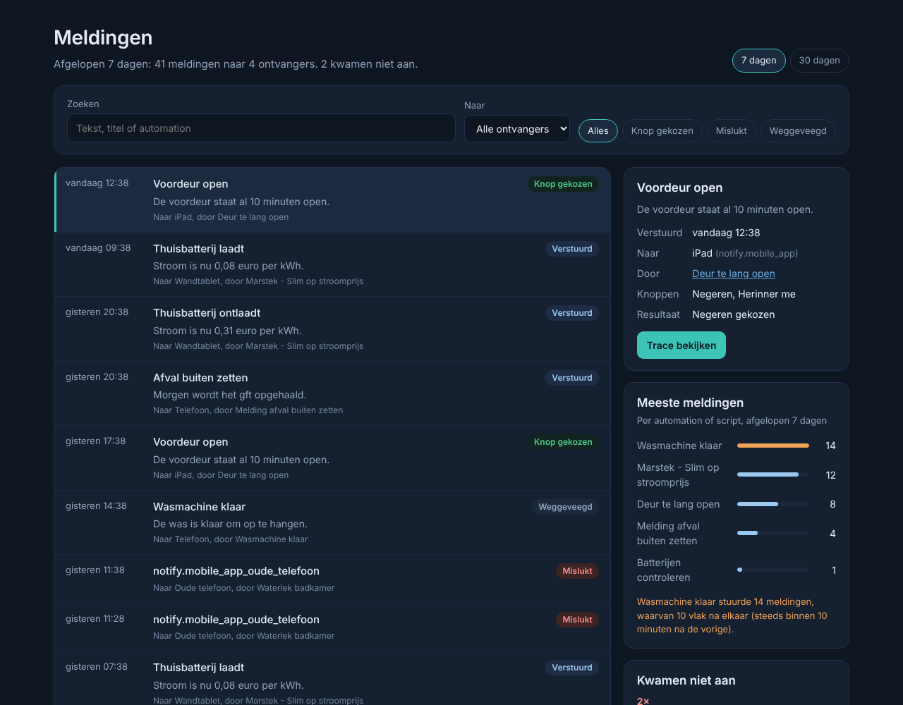

# Fonfey's Home Assistant addons

Store-repository voor Home Assistant. Hier staan de app-beschrijvingen; de code staat in de eigen repository van elke app en wordt als kant-en-klaar image geleverd.

## De apps

### UniFi Dashboard

Live overzicht van je UniFi-netwerk: netwerkkaart, internetverkeer tot 24 uur terug, wat er op elke switchpoort zit, wifi-radio's en clients met SSID, VLAN en signaal. Met inzichten (netwerkcheck, dataverbruik per app, flows), het systeemlogboek, opslag en back-ups, en de afbeeldingen uit UniFi. [Documentatie](unifi_dashboard/DOCS.md) · code in [HomeAssistantUnifi](https://github.com/Fonfey/HomeAssistantUnifi)

*Overzicht: de netwerkkaart met je provider en het internetverkeer. Klik op Internet, een apparaat of een client voor de details.*

*De pagina van een switch: per poort wat erop zit.*

*De pagina van een client: wifi-netwerk, signaal in dBm, band, VLAN en via welk apparaat en welke poort.*

*Inzichten: netwerkcheck, dataverbruik per app en flows.*

Met je eigen console zie je de echte afbeeldingen en iconen uit UniFi; de screenshots gebruiken voorbeeldgegevens.

### AdGuard DNS Dashboard

Statistieken van je AdGuard DNS-account, querylog, blokkeren en deblokkeren, blokkeerlijsten en serverinstellingen. [Documentatie](adguard_dns/DOCS.md) · code in [HomeAssistantAdguard](https://github.com/Fonfey/HomeAssistantAdguard)

*AdGuard DNS Dashboard met voorbeeldgegevens: het overzicht met verzoeken, blokkades, servers en apparaten.*

### Onderhoud

Eén lijst met wat aandacht nodig heeft in je Home Assistant: back-ups, offline apparaten, batterijen, sensoren zonder data, automations die elkaar tegenwerken of nooit draaien, en wat je kunt opruimen. Verwijder je een automation en heb je de Tijdmachine, dan zet je hem met één knop terug. [Documentatie](onderhoud/DOCS.md) · code in [HomeAssistantOnderhoud](https://github.com/Fonfey/HomeAssistantOnderhoud)

*Onderhoud met voorbeeldgegevens: de punten op volgorde van belang, van Belangrijk via Nalopen naar Opruimen.*

### Tijdmachine

Bewaart bij elke wijziging een versie van je automations, scripts, scènes, dashboards en helpers. Je ziet per onderdeel wat er veranderde, regel voor regel, en zet één onderdeel terug, ook als je het hebt verwijderd, bijvoorbeeld vanuit Onderhoud. [Documentatie](tijdmachine/DOCS.md) · code in [HA_Timemachine](https://github.com/Fonfey/HA_Timemachine)

*Tijdmachine met voorbeeldgegevens: links de onderdelen, rechts de versies van een automation en wat er veranderde.*

### Meldingen

Zie welke meldingen Home Assistant verstuurt: wanneer, naar wie, door welke automation, en of er op een knop is gedrukt, de melding is weggeveegd of het versturen mislukte. [Documentatie](meldingen/DOCS.md) · code in [HA_Alerts](https://github.com/Fonfey/HA_Alerts)

*Meldingen met voorbeeldgegevens: de lijst, de details en de automations die de meeste meldingen sturen.*

## Installeren in Home Assistant

1. Ga naar **Instellingen → Apps → App Store**.
2. Klik rechtsboven op **⋮ → Repositories** en voeg deze URL toe:
   `https://github.com/Fonfey/hassio-addons`
3. De apps staan nu onder **Fonfey's Home Assistant addons**. Installeer wat je wilt en start de app. UniFi en AdGuard vragen op het tabblad **Configuratie** om een API-key.

De apps worden geleverd als kant-en-klare images op `ghcr.io/fonfey`. Je hebt geen token of extra login nodig.

Onderhoud, Tijdmachine en Meldingen draaien helemaal lokaal: ze praten alleen met je eigen Home Assistant en laden niets van internet, ook geen lettertypen. Het UniFi Dashboard praat daarnaast met je eigen UniFi-console, en het AdGuard DNS Dashboard met de AdGuard DNS-dienst.
