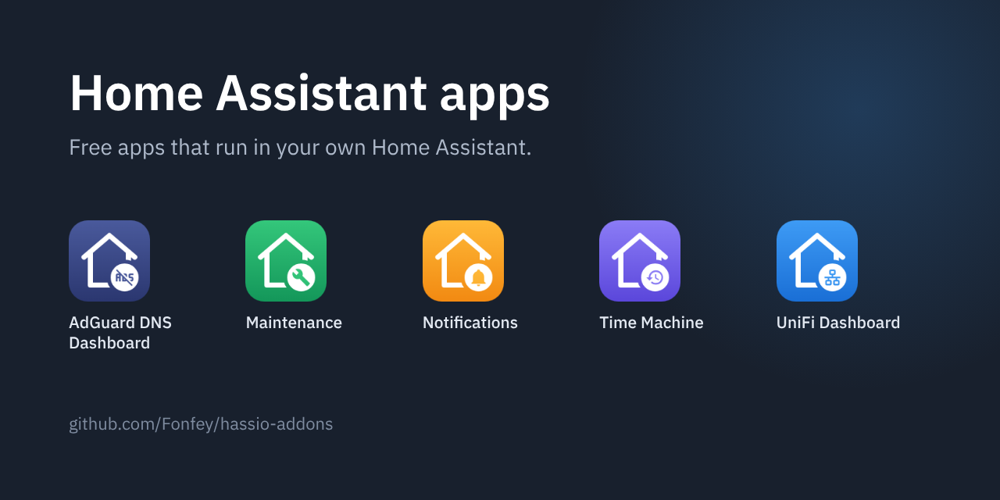
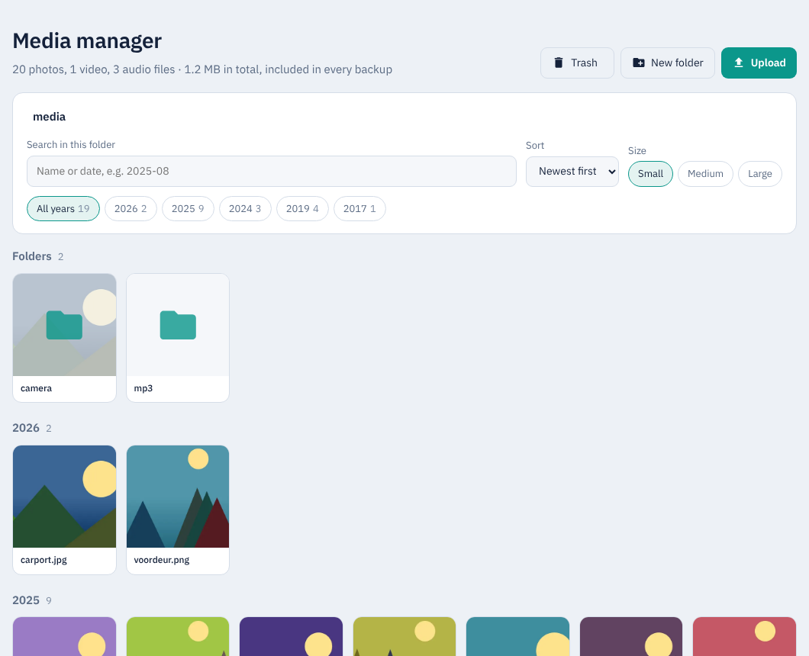
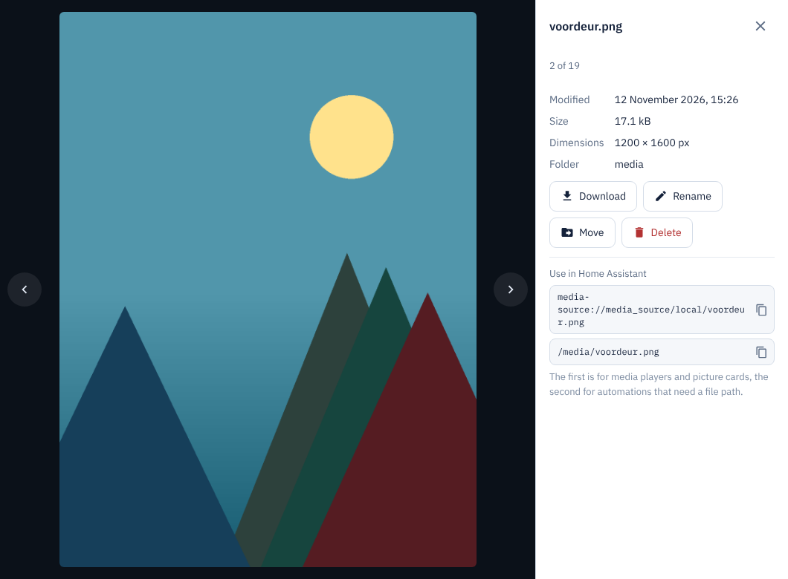
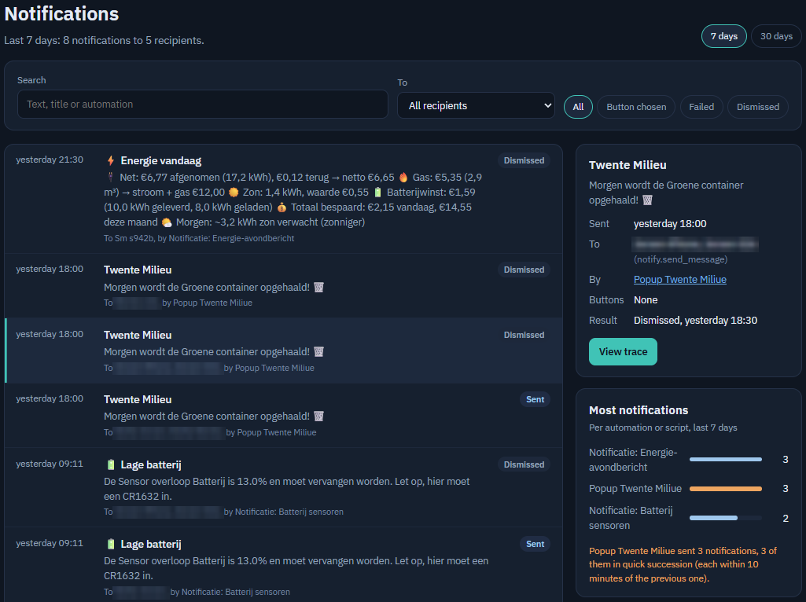
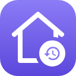

# Fonfey's Home Assistant addons

🇳🇱 [Lees in het Nederlands](README.nl.md)

Store repository for Home Assistant. Each app has its own folder with the code, the documentation and the changelog, and is delivered as a ready-made image. Every app follows the language of your Home Assistant: Dutch if Home Assistant is set to Dutch, English otherwise.

## The apps

###  AdGuard DNS Dashboard

Statistics of your AdGuard DNS account, query log, blocking and unblocking, blocklists and server settings. [Documentation](adguard_dns/DOCS.md) · code in [`adguard_dns/`](adguard_dns)

**Note:** this app is for **AdGuard DNS**, the cloud DNS service run by AdGuard (adguard-dns.io). It does not work with **AdGuard Home**, the free software you install and run yourself; for AdGuard Home, use the official AdGuard Home integration in Home Assistant.

*The dashboard, statistics and companies, from a real AdGuard DNS account.*

###  Maintenance

One list of what needs attention in your Home Assistant: backups, offline devices, batteries, sensors without data, automations that work against each other or never run, and what you can clean up. If you delete an automation and have Time Machine, you restore it with one button. [Documentation](maintenance/DOCS.md) · code in [`maintenance/`](maintenance)

*Items from a real Home Assistant: a repair, an offline device and an automation that has never run.*

###  Media manager

The media folder with real thumbnails, the full file name and the date the photo was taken, instead of grey icons with cut-off names. Upload by dragging, rename, move, download and delete, with a trash to undo mistakes. Copy the `media-source://` address or the file path to use a file in a card or automation. You choose which folder it shows. [Documentation](media_manager/DOCS.md) · code in [`media_manager/`](media_manager)

*The overview and a photo viewed large, with sample photos.*

###  Notifications

See which notifications Home Assistant sends: when, to whom, from which automation, and whether a button was pressed, the notification was dismissed or sending failed. [Documentation](notifications/DOCS.md) · code in [`notifications/`](notifications)

*The list, the details and the automations that send the most notifications. Recipient names are blurred.*

###  Time Machine

Keeps a version of your automations, scripts, scenes, dashboards and helpers on every change. Per item you see what changed, line by line, and restore a single item, even if you deleted it, for example from Maintenance. Versions you no longer need can be discarded one by one. [Documentation](time_machine/DOCS.md) · code in [`time_machine/`](time_machine)

*Versions of a dashboard and of an automation, with what changed line by line.*

###  UniFi Dashboard

A live overview of your UniFi network: network map, internet traffic up to 24 hours back, what is connected to every switch port, Wi-Fi radios and clients with SSID, VLAN and signal. With insights (network check, data usage per app, flows), the system log, storage and backups, and the pictures from UniFi. [Documentation](unifi_dashboard/DOCS.md) · code in [`unifi_dashboard/`](unifi_dashboard)

*Network map, network check and an access point, from a real UniFi network.*

## Installing in Home Assistant

The quickest way is this button. It opens your own Home Assistant with this repository already filled in:

Or add it by hand:

1. Go to **Settings → Apps → App Store**.
2. Click **⋮ → Repositories** in the top right and add this URL:
   `https://github.com/Fonfey/hassio-addons`
3. The apps now appear under **Fonfey's Home Assistant addons**. Install what you want and start the app. UniFi and AdGuard ask for an API key on the **Configuration** tab.

The apps are delivered as ready-made images on `ghcr.io/fonfey`. You do not need a token or extra login.

Maintenance, Media manager, Time Machine and Notifications run completely locally: they only talk to your own Home Assistant and load nothing from the internet, not even fonts. The UniFi Dashboard also talks to your own UniFi console, and the AdGuard DNS Dashboard to the AdGuard DNS service.

## For developers

Every app folder contains everything for that app: `config.yaml`, the code, the `Dockerfile`, `DOCS.md`, `CHANGELOG.md` and the translations. When a folder changes on `main`, GitHub Actions builds the image for amd64 and aarch64 and publishes it on `ghcr.io/fonfey`. For a new version, raise `version` in `config.yaml` and add it to `CHANGELOG.md`; Home Assistant then offers the update.

To try an app or work on the code without Home Assistant, every app also runs on its own computer with sample data. You only need Python 3; nothing has to be installed. Run the command from the root of this repository and open the address in your browser:

| App | Command | Address |
| --- | --- | --- |
| AdGuard DNS Dashboard | `python3 adguard_dns/adguard_dashboard.py --demo` | http://localhost:8081 |
| Maintenance | `python3 maintenance/maintenance.py --demo` | http://localhost:8082 |
| Media manager | `python3 media_manager/media_manager.py --demo` | http://localhost:8095 |
| Notifications | `python3 notifications/notifications.py --demo` | http://localhost:8093 |
| Time Machine | `python3 time_machine/time_machine.py --demo` | http://localhost:8091 |
| UniFi Dashboard | `python3 unifi_dashboard/unifi_dashboard.py --demo` | http://localhost:8080 |

Media manager makes sample photos in `media_manager/demo_media` the first time; for those and for the thumbnails it needs the Python image library Pillow (`pip install pillow`). Without Pillow it still runs, but without thumbnails. Add `?lang=en` or `?lang=nl` to the address to choose a language. This is only for testing: to use the apps, install them in Home Assistant as described above.

Licensed under the [MIT license](LICENSE). The bundled IBM Plex fonts are under the SIL Open Font License (see `fonts/OFL.txt` in the app folders).
