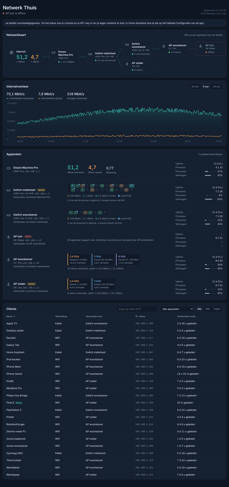
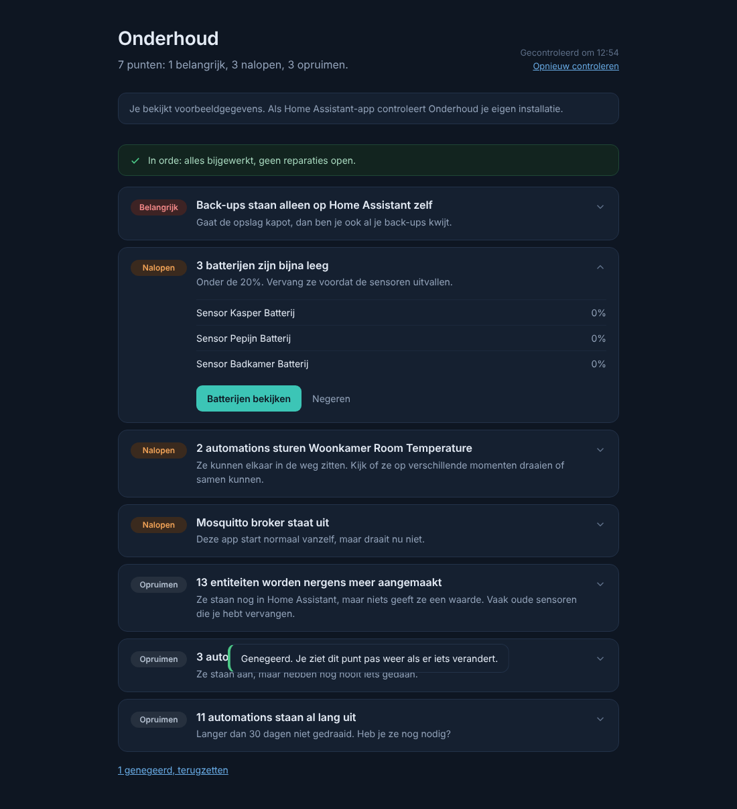

# Fonfey's Home Assistant addons

Store-repository voor Home Assistant. Hier staan de app-beschrijvingen; de code staat in de eigen repository van elke app en wordt als kant-en-klaar image geleverd.

## De apps

### UniFi Dashboard

Live overzicht van je UniFi-netwerk: netwerkkaart, internetverkeer tot 24 uur terug, switchpoorten, wifi-radio's en clients. [Documentatie](unifi_dashboard/DOCS.md) · code in [HomeAssistantUnifi](https://github.com/Fonfey/HomeAssistantUnifi)

*UniFi Dashboard met voorbeeldgegevens: bovenaan de netwerkkaart, daaronder het internetverkeer, de apparaten met poorten en wifi-radio's, en de lijst met clients.*

### AdGuard DNS Dashboard

Statistieken van je AdGuard DNS-account, querylog, blokkeren en deblokkeren, blokkeerlijsten en serverinstellingen. [Documentatie](adguard_dns/DOCS.md) · code in [HomeAssistantAdguard](https://github.com/Fonfey/HomeAssistantAdguard)

*AdGuard DNS Dashboard met voorbeeldgegevens: het overzicht met verzoeken, blokkades, servers en apparaten.*

### Onderhoud

Eén lijst met wat aandacht nodig heeft in je Home Assistant: back-ups, offline apparaten, batterijen, sensoren zonder data, automations die botsen of nooit draaien, en wat je kunt opruimen. [Documentatie](onderhoud/DOCS.md) · code in [HomeAssistantOnderhoud](https://github.com/Fonfey/HomeAssistantOnderhoud)

*Onderhoud met voorbeeldgegevens: de punten op volgorde van belang, van Belangrijk via Nalopen naar Opruimen.*

## Installeren in Home Assistant

1. Ga naar **Instellingen → Apps → App Store**.
2. Klik rechtsboven op **⋮ → Repositories** en voeg deze URL toe:
   `https://github.com/Fonfey/hassio-addons`
3. De apps staan nu onder **Fonfey's Home Assistant addons**. Installeer wat je wilt en start de app. UniFi en AdGuard vragen op het tabblad **Configuratie** om een API-key; Onderhoud heeft er geen nodig.

De apps worden geleverd als kant-en-klare images op `ghcr.io/fonfey`. Je hebt geen token of extra login nodig.
