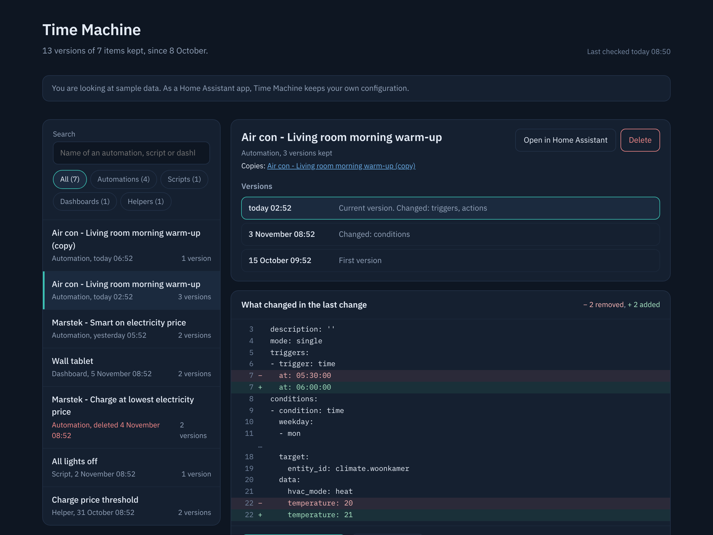
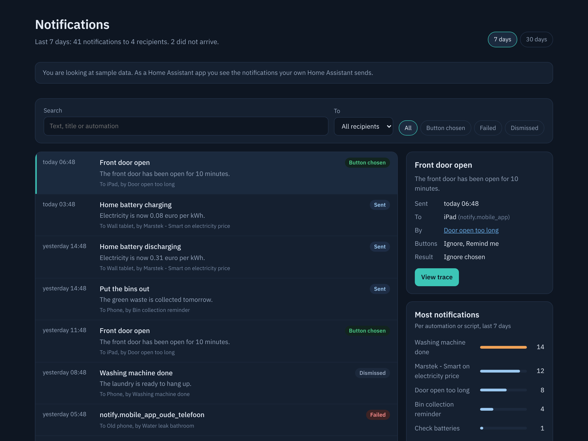

# Fonfey's Home Assistant addons

[English](#english) · [Nederlands](#nederlands)

## English

Store repository for Home Assistant. This is where the app descriptions live; the code of each app is in its own repository and is delivered as a ready-made image. Every app follows the language of your Home Assistant: Dutch if Home Assistant is set to Dutch, English otherwise.

### The apps

#### UniFi Dashboard

A live overview of your UniFi network: network map, internet traffic up to 24 hours back, what is connected to every switch port, Wi-Fi radios and clients with SSID, VLAN and signal. With insights (network check, data usage per app, flows), the system log, storage and backups, and the pictures from UniFi. [Documentation](unifi_dashboard/DOCS.md) · code in [HomeAssistantUnifi](https://github.com/Fonfey/HomeAssistantUnifi)

*Overview: the network map with your provider and the internet traffic. Click Internet, a device or a client for details.*

*The page of a switch: what is connected to each port.*

*The page of a client: network, VLAN and via which device and port.*

*Insights: network check, data usage per app and flows.*

With your own console you see the real pictures and icons from UniFi; the screenshots use sample data.

#### AdGuard DNS Dashboard

Statistics of your AdGuard DNS account, query log, blocking and unblocking, blocklists and server settings. [Documentation](adguard_dns/DOCS.md) · code in [HomeAssistantAdguard](https://github.com/Fonfey/HomeAssistantAdguard)

*AdGuard DNS Dashboard with sample data: the overview with requests, blocks, servers and devices.*

#### Maintenance

One list of what needs attention in your Home Assistant: backups, offline devices, batteries, sensors without data, automations that work against each other or never run, and what you can clean up. If you delete an automation and have Time Machine, you restore it with one button. [Documentation](onderhoud/DOCS.md) · code in [HomeAssistantOnderhoud](https://github.com/Fonfey/HomeAssistantOnderhoud)

*Maintenance with sample data: the items in order of importance, from Important via Check to Clean up.*

#### Time Machine

Keeps a version of your automations, scripts, scenes, dashboards and helpers on every change. Per item you see what changed, line by line, and restore a single item, even if you deleted it, for example from Maintenance. Versions you no longer need can be discarded one by one. [Documentation](tijdmachine/DOCS.md) · code in [HA_Timemachine](https://github.com/Fonfey/HA_Timemachine)

*Time Machine with sample data: the items on the left, the versions of an automation and what changed on the right.*

#### Notifications

See which notifications Home Assistant sends: when, to whom, from which automation, and whether a button was pressed, the notification was dismissed or sending failed. [Documentation](meldingen/DOCS.md) · code in [HA_Alerts](https://github.com/Fonfey/HA_Alerts)

*Notifications with sample data: the list, the details and the automations that send the most notifications.*

### Installing in Home Assistant

1. Go to **Settings → Apps → App Store**.
2. Click **⋮ → Repositories** in the top right and add this URL:
   `https://github.com/Fonfey/hassio-addons`
3. The apps now appear under **Fonfey's Home Assistant addons**. Install what you want and start the app. UniFi and AdGuard ask for an API key on the **Configuration** tab.

The apps are delivered as ready-made images on `ghcr.io/fonfey`. You do not need a token or extra login.

Maintenance, Time Machine and Notifications run completely locally: they only talk to your own Home Assistant and load nothing from the internet, not even fonts. The UniFi Dashboard also talks to your own UniFi console, and the AdGuard DNS Dashboard to the AdGuard DNS service.

## Nederlands

Store-repository voor Home Assistant. Hier staan de app-beschrijvingen; de code staat in de eigen repository van elke app en wordt als kant-en-klaar image geleverd. Elke app volgt de taal van je Home Assistant: Nederlands als Home Assistant Nederlands is, anders Engels.

### De apps

#### UniFi Dashboard

Live overzicht van je UniFi-netwerk: netwerkkaart, internetverkeer tot 24 uur terug, wat er op elke switchpoort zit, wifi-radio's en clients met SSID, VLAN en signaal. Met inzichten (netwerkcheck, dataverbruik per app, flows), het systeemlogboek, opslag en back-ups, en de afbeeldingen uit UniFi. [Documentatie](unifi_dashboard/DOCS.md) · code in [HomeAssistantUnifi](https://github.com/Fonfey/HomeAssistantUnifi)

*Overzicht: de netwerkkaart met je provider en het internetverkeer. Klik op Internet, een apparaat of een client voor de details.*

*De pagina van een switch: per poort wat erop zit.*

*De pagina van een client: wifi-netwerk, signaal in dBm, band, VLAN en via welk apparaat en welke poort.*

*Inzichten: netwerkcheck, dataverbruik per app en flows.*

Met je eigen console zie je de echte afbeeldingen en iconen uit UniFi; de screenshots gebruiken voorbeeldgegevens.

#### AdGuard DNS Dashboard

Statistieken van je AdGuard DNS-account, querylog, blokkeren en deblokkeren, blokkeerlijsten en serverinstellingen. [Documentatie](adguard_dns/DOCS.md) · code in [HomeAssistantAdguard](https://github.com/Fonfey/HomeAssistantAdguard)

*AdGuard DNS Dashboard met voorbeeldgegevens: het overzicht met verzoeken, blokkades, servers en apparaten.*

#### Maintenance (Onderhoud)

Eén lijst met wat aandacht nodig heeft in je Home Assistant: back-ups, offline apparaten, batterijen, sensoren zonder data, automations die elkaar tegenwerken of nooit draaien, en wat je kunt opruimen. Verwijder je een automation en heb je de Tijdmachine, dan zet je hem met één knop terug. [Documentatie](onderhoud/DOCS.md) · code in [HomeAssistantOnderhoud](https://github.com/Fonfey/HomeAssistantOnderhoud)

*Onderhoud met voorbeeldgegevens: de punten op volgorde van belang, van Belangrijk via Nalopen naar Opruimen.*

#### Time Machine (Tijdmachine)

Bewaart bij elke wijziging een versie van je automations, scripts, scènes, dashboards en helpers. Je ziet per onderdeel wat er veranderde, regel voor regel, en zet één onderdeel terug, ook als je het hebt verwijderd, bijvoorbeeld vanuit Onderhoud. Versies die je niet meer nodig hebt, gooi je een voor een weg. [Documentatie](tijdmachine/DOCS.md) · code in [HA_Timemachine](https://github.com/Fonfey/HA_Timemachine)

*Tijdmachine met voorbeeldgegevens: links de onderdelen, rechts de versies van een automation en wat er veranderde.*

#### Notifications (Meldingen)

Zie welke meldingen Home Assistant verstuurt: wanneer, naar wie, door welke automation, en of er op een knop is gedrukt, de melding is weggeveegd of het versturen mislukte. [Documentatie](meldingen/DOCS.md) · code in [HA_Alerts](https://github.com/Fonfey/HA_Alerts)

*Meldingen met voorbeeldgegevens: de lijst, de details en de automations die de meeste meldingen sturen.*

### Installeren in Home Assistant

1. Ga naar **Instellingen → Apps → App Store**.
2. Klik rechtsboven op **⋮ → Repositories** en voeg deze URL toe:
   `https://github.com/Fonfey/hassio-addons`
3. De apps staan nu onder **Fonfey's Home Assistant addons**. Installeer wat je wilt en start de app. UniFi en AdGuard vragen op het tabblad **Configuratie** om een API-key.

De apps worden geleverd als kant-en-klare images op `ghcr.io/fonfey`. Je hebt geen token of extra login nodig.

Onderhoud, Tijdmachine en Meldingen draaien helemaal lokaal: ze praten alleen met je eigen Home Assistant en laden niets van internet, ook geen lettertypen. Het UniFi Dashboard praat daarnaast met je eigen UniFi-console, en het AdGuard DNS Dashboard met de AdGuard DNS-dienst.
