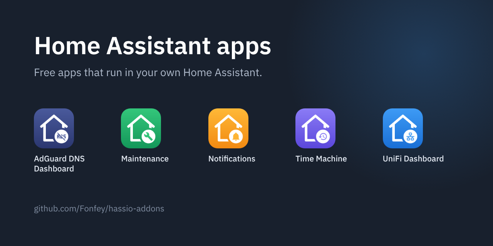
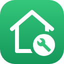
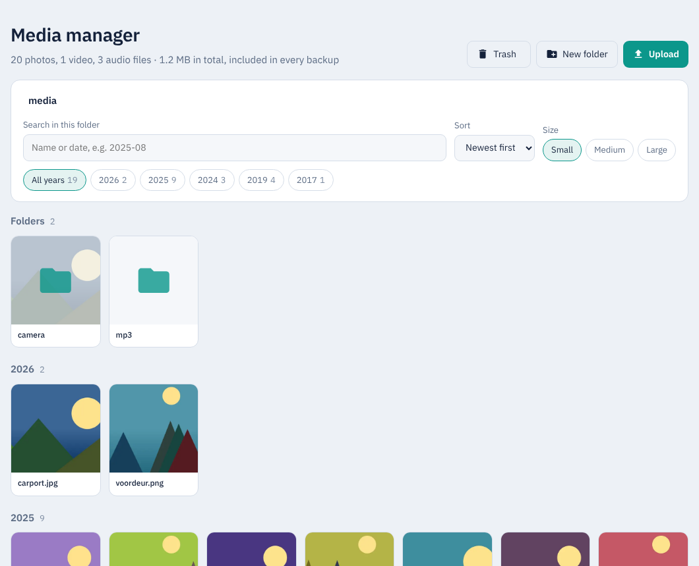
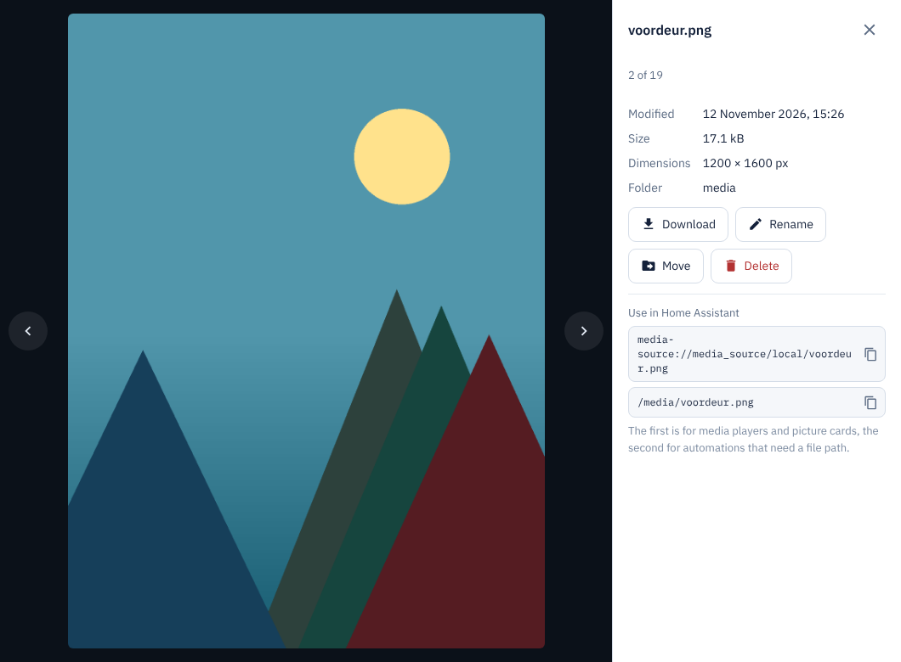
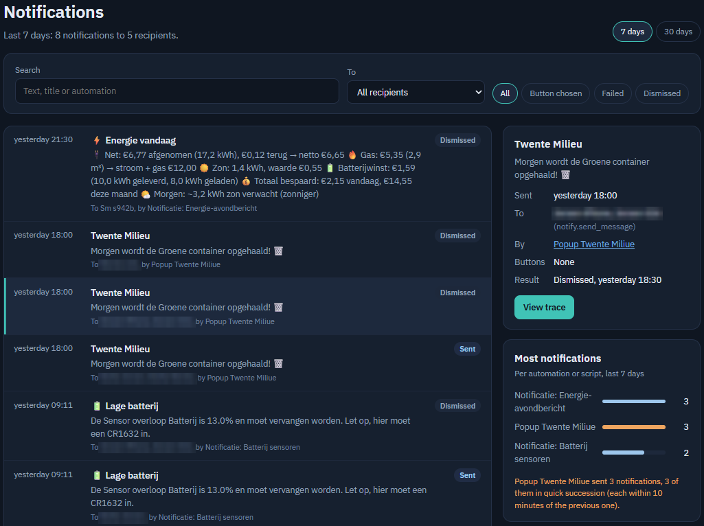
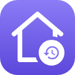
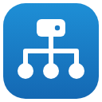

# Fonfey's Home Assistant addons

🇬🇧 [Read in English](README.md)

Store-repository voor Home Assistant. Elke app heeft een eigen map met de code, de documentatie en de changelog, en wordt als kant-en-klaar image geleverd. Elke app volgt de taal van je Home Assistant: Nederlands als Home Assistant Nederlands is, anders Engels.

## De apps

###  AdGuard DNS Dashboard

Statistieken van je AdGuard DNS-account, querylog, blokkeren en deblokkeren, blokkeerlijsten en serverinstellingen. [Documentatie](adguard_dns/DOCS.md) · code in [`adguard_dns/`](adguard_dns)

**Let op:** deze app is voor **AdGuard DNS**, de DNS-dienst in de cloud van AdGuard (adguard-dns.io). Hij werkt niet met **AdGuard Home**, de gratis software die je zelf installeert en draait; gebruik voor AdGuard Home de officiële AdGuard Home-integratie van Home Assistant.

*Het dashboard, de statistieken en de bedrijven, van een echt AdGuard DNS-account.*

###  Maintenance (Onderhoud)

Eén lijst met wat aandacht nodig heeft in je Home Assistant: back-ups, offline apparaten, batterijen, sensoren zonder data, automations die elkaar tegenwerken of nooit draaien, en wat je kunt opruimen. Verwijder je een automation en heb je de Tijdmachine, dan zet je hem met één knop terug. [Documentatie](maintenance/DOCS.md) · code in [`maintenance/`](maintenance)

*Punten uit een echte Home Assistant: een reparatie, een offline apparaat en een automation die nooit is gestart.*

###  Media manager

De mediamap met echte miniaturen, de volledige bestandsnaam en de datum waarop de foto is gemaakt, in plaats van grijze iconen met afgekapte namen. Uploaden door te slepen, hernoemen, verplaatsen, downloaden en verwijderen, met een prullenbak om vergissingen terug te draaien. Kopieer het `media-source://`-adres of het bestandspad om een bestand in een kaart of automation te gebruiken. Je kiest zelf welke map hij toont. [Documentatie](media_manager/DOCS.md) · code in [`media_manager/`](media_manager)

*Het overzicht en een foto groot bekeken, met voorbeeldfoto's.*

###  Notifications (Meldingen)

Zie welke meldingen Home Assistant verstuurt: wanneer, naar wie, door welke automation, en of er op een knop is gedrukt, de melding is weggeveegd of het versturen mislukte. [Documentatie](notifications/DOCS.md) · code in [`notifications/`](notifications)

*De lijst, de details en de automations die de meeste meldingen sturen. De namen van de ontvangers zijn onherkenbaar gemaakt.*

###  Time Machine (Tijdmachine)

Bewaart bij elke wijziging een versie van je automations, scripts, scènes, dashboards en helpers. Je ziet per onderdeel wat er veranderde, regel voor regel, en zet één onderdeel terug, ook als je het hebt verwijderd, bijvoorbeeld vanuit Onderhoud. Versies die je niet meer nodig hebt, gooi je een voor een weg. [Documentatie](time_machine/DOCS.md) · code in [`time_machine/`](time_machine)

*Versies van een dashboard en van een automation, met regel voor regel wat er veranderde.*

###  UniFi Dashboard

Live overzicht van je UniFi-netwerk: netwerkkaart, internetverkeer tot 24 uur terug, wat er op elke switchpoort zit, wifi-radio's en clients met SSID, VLAN en signaal. Met inzichten (netwerkcheck, dataverbruik per app, flows), het systeemlogboek, opslag en back-ups, en de afbeeldingen uit UniFi. [Documentatie](unifi_dashboard/DOCS.md) · code in [`unifi_dashboard/`](unifi_dashboard)

*Netwerkkaart, netwerkcheck en een toegangspunt, van een echt UniFi-netwerk.*

## Installeren in Home Assistant

Het snelst gaat het met deze knop. Hij opent je eigen Home Assistant met deze repository al ingevuld:

Of voeg hem met de hand toe:

1. Ga naar **Instellingen → Apps → App Store**.
2. Klik rechtsboven op **⋮ → Repositories** en voeg deze URL toe:
   `https://github.com/Fonfey/hassio-addons`
3. De apps staan nu onder **Fonfey's Home Assistant addons**. Installeer wat je wilt en start de app. UniFi en AdGuard vragen op het tabblad **Configuratie** om een API-key.

De apps worden geleverd als kant-en-klare images op `ghcr.io/fonfey`. Je hebt geen token of extra login nodig.

Onderhoud, Media manager, Tijdmachine en Meldingen draaien helemaal lokaal: ze praten alleen met je eigen Home Assistant en laden niets van internet, ook geen lettertypen. Het UniFi Dashboard praat daarnaast met je eigen UniFi-console, en het AdGuard DNS Dashboard met de AdGuard DNS-dienst.

## Voor ontwikkelaars

Elke app-map bevat alles van die app: `config.yaml`, de code, de `Dockerfile`, `DOCS.md`, `CHANGELOG.md` en de vertalingen. Verandert een map op `main`, dan bouwt GitHub Actions het image voor amd64 en aarch64 en zet het op `ghcr.io/fonfey`. Voor een nieuwe versie verhoog je `version` in `config.yaml` en vul je `CHANGELOG.md` aan; Home Assistant biedt dan de update aan.

Wil je een app uitproberen of aan de code werken zonder Home Assistant, dan draait elke app ook los op je computer, met voorbeeldgegevens. Je hebt alleen Python 3 nodig; er hoeft niets geïnstalleerd te worden. Voer het commando uit in de hoofdmap van deze repository en open het adres in je browser:

| App | Commando | Adres |
| --- | --- | --- |
| AdGuard DNS Dashboard | `python3 adguard_dns/adguard_dashboard.py --demo` | http://localhost:8081 |
| Maintenance | `python3 maintenance/maintenance.py --demo` | http://localhost:8082 |
| Media manager | `python3 media_manager/media_manager.py --demo` | http://localhost:8095 |
| Notifications | `python3 notifications/notifications.py --demo` | http://localhost:8093 |
| Time Machine | `python3 time_machine/time_machine.py --demo` | http://localhost:8091 |
| UniFi Dashboard | `python3 unifi_dashboard/unifi_dashboard.py --demo` | http://localhost:8080 |

Media manager maakt de eerste keer voorbeeldfoto's in `media_manager/demo_media`; daarvoor en voor de miniaturen heeft hij de Python-beeldbibliotheek Pillow nodig (`pip install pillow`). Zonder Pillow draait hij ook, maar zonder miniaturen. Zet `?lang=en` of `?lang=nl` achter het adres om een taal te kiezen. Dit is alleen om te testen: om de apps te gebruiken installeer je ze in Home Assistant, zoals hierboven beschreven.

Valt onder de [MIT-licentie](LICENSE). De meegeleverde IBM Plex-lettertypen vallen onder de SIL Open Font License (zie `fonts/OFL.txt` in de app-mappen).
